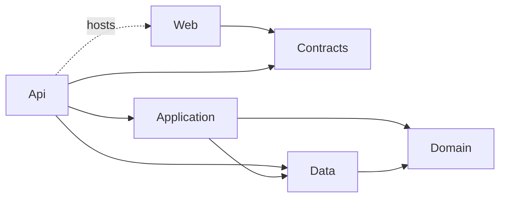

# LedgerLite

**A double-entry ledger engine built from scratch in C# to learn how core banking ledgers work.**

[](https://dotnet.microsoft.com/)
[](https://dotnet.microsoft.com/apps/aspnet/web-apps/blazor)
[](https://learn.microsoft.com/ef/core/)

LedgerLite records financial events as balanced journal entries, derives every balance from them, and corrects
mistakes with reversals instead of edits. It is a portfolio project: the data is fictional, no real money is
involved, and it is not affiliated with any bank, SACCO or employer.

<!-- Add after deployment:
**Live demo:** https://your-domain
-->

## What it does

- **Chart of accounts** with five account types (Asset, Liability, Equity, Income, Expense) and parent/control accounts
- **Balanced journal entries**: two or more lines, debits must equal credits, or nothing is saved
- **Reversals, never edits**: a posted entry is immutable; a mistake is cancelled by a new, linked entry with debits and credits flipped (reversible once, and a reversal can't be reversed)
- **Idempotent posting**: a retried request with the same key returns the original entry instead of posting twice
- **Account ledgers** with an opening balance, a running balance and a closing balance for any date range
- **Trial balance** as of any date, which proves the books balance
- **Dashboard** showing the accounting equation (`Assets = Liabilities + Equity + Net income`) and flagging accounts with an unusual balance
- **Google and GitHub sign-in** with an Owner role (can post and reverse) and a read-only Visitor role
- **Rate limiting** and a documented path to a hardened VPS deployment

<!-- Add screenshots to docs/images and uncomment:


-->

## Quick start

**Prerequisites:** the [.NET 10 SDK](https://dotnet.microsoft.com/download) and SQL Server
(LocalDB on Windows, or SQL Server in Docker on macOS/Linux).

```bash
git clone https://github.com/KOKUMUbooker/ledger-lite.git
cd ledger-lite

# EF Core tooling is a local tool (recorded in .config/dotnet-tools.json), not a global install
dotnet tool restore

# Configuration lives in .env (never committed). Copy the example and edit it.
cp .env.example .env            # PowerShell: Copy-Item .env.example .env

# Create the database (applies migrations and seeds the starter chart of accounts)
dotnet ef database update -p LedgerLite.Data -s LedgerLite.Api

# Run. The Api serves the Blazor app too, so there is only one thing to start.
dotnet run --project LedgerLite.Api
```

Open **http://localhost:5059**.

To get in without setting up OAuth, use the development-only sign-in (enabled by `Auth__EnableDevLogin=true`
in `.env.example`):

- Owner: <http://localhost:5059/api/auth/dev-login?returnUrl=/>
- Read-only visitor: <http://localhost:5059/api/auth/dev-login?role=visitor&returnUrl=/>

Starter accounts: `1000 Cash`, `1200 Loan Receivable`, `2000 Customer Deposits`, `3000 Share Capital`,
`4000 Interest Income`, `5000 Interest Expense`. To see how entries work, open **How it works** in the app and
try one of the worked examples.

## Configuration

All settings come from environment variables, loaded from `.env` at startup. Nested settings use a double
underscore (`Authentication__Google__ClientId` is `Authentication:Google:ClientId`). Real environment variables
always win over the file, which is what you want on a server.

| Variable                                            | Purpose                                                                                                                   |
| --------------------------------------------------- | ------------------------------------------------------------------------------------------------------------------------- |
| `ConnectionStrings__LedgerDb`                       | SQL Server connection string                                                                                              |
| `Authentication__Google__ClientId` / `ClientSecret` | Google sign-in. Leave empty to disable                                                                                    |
| `Authentication__GitHub__ClientId` / `ClientSecret` | GitHub sign-in. Leave empty to disable                                                                                    |
| `Auth__Owners__0`, `Auth__Owners__1`, ...           | Provider-prefixed IDs allowed to post and reverse, e.g. `github:1234567`. Sign in once and read yours from `/api/auth/me` |
| `Auth__EnableDevLogin`                              | Development-only sign-in without OAuth. Leave unset in production                                                         |
| `RateLimiting__*`                                   | Optional limits (defaults are fine)                                                                                       |
| `Proxy__KnownProxies__0`                            | Extra trusted reverse-proxy IPs (loopback is always trusted)                                                              |

See [`.env.example`](.env.example) for the full annotated list, including the OAuth callback URLs to register
(`/signin-google` and `/signin-github`).

## Running the tests

```bash
dotnet test
```

The domain tests are plain unit tests. The application tests run against a real SQL Server (so that constraints,
unique indexes and the check constraint are exercised, not faked). Point them at one with:

```bash
# PowerShell
$env:LEDGERLITE_TEST_CONNECTION = "Server=(localdb)\MSSQLLocalDB;Trusted_Connection=True;TrustServerCertificate=True"
# bash
export LEDGERLITE_TEST_CONNECTION="Server=localhost,1433;User Id=sa;Password=<password>;TrustServerCertificate=True"
```

Each test run creates its own uniquely named database and drops it afterwards.

## Architecture



| Project                  | Responsibility                                                                                           |
| ------------------------ | -------------------------------------------------------------------------------------------------------- |
| `LedgerLite.Domain`      | Entities and invariants (balanced entries, one side per line, reversal rules). No dependencies           |
| `LedgerLite.Data`        | EF Core `DbContext`, configurations, migrations, seed data, database constraints                         |
| `LedgerLite.Application` | One use-case class per operation (post, reverse, ledger, trial balance, ...) and its exceptions          |
| `LedgerLite.Contracts`   | DTOs shared by the Api and the web app                                                                   |
| `LedgerLite.Api`         | Thin controllers, error handling, auth, rate limiting. Also serves the Blazor app (same origin, no CORS) |
| `LedgerLite.Web`         | Blazor WebAssembly UI built with [Bit BlazorUI](https://blazorui.bitplatform.dev/)                       |
| `*.Tests`                | Domain unit tests and SQL Server-backed application tests                                                |

### Design decisions

- **Balances are derived, never stored.** An account's balance is always computed from its journal lines, so it cannot drift out of sync.
- **Posted entries are immutable.** The domain exposes no edit; an optional migration also installs `INSTEAD OF UPDATE/DELETE` triggers so the database refuses changes too.
- **Invariants are enforced in layers:** domain factory methods, then a database check constraint (a line is a debit or a credit, never both), then filtered unique indexes (idempotency key, one reversal per entry).
- **Money is `decimal(18,2)`**, and the accounting date (`DateOnly`) is kept separate from the moment of posting (`PostedAt`, UTC), so backdating is explicit.
- **Errors are ProblemDetails** with a stable `code`: `404` not found, `409` conflict (duplicate code, already reversed), `422` business rule, `400` invalid input or domain rule broken, `429` rate limited.
- **The Api hosts the web app,** so the sign-in cookie is a plain same-origin HttpOnly cookie, with no tokens in the browser.

## API overview

| Method | Route                                            | Notes                                                     |
| ------ | ------------------------------------------------ | --------------------------------------------------------- |
| GET    | `/api/accounts?type=`                            | List accounts                                             |
| POST   | `/api/accounts`                                  | Create an account (Owner)                                 |
| GET    | `/api/accounts/{id}/ledger?from=&to=`            | Ledger with running balance                               |
| GET    | `/api/journal-entries?from=&to=&page=&pageSize=` | Paged, newest first                                       |
| POST   | `/api/journal-entries`                           | Post an entry (Owner). `201` new, `200` idempotent replay |
| GET    | `/api/journal-entries/{id}`                      | One entry, with `reversalOfEntryId` / `reversedByEntryId` |
| POST   | `/api/journal-entries/{id}/reverse`              | Reverse an entry (Owner)                                  |
| GET    | `/api/reports/trial-balance?asOf=`               | Trial balance                                             |
| GET    | `/api/auth/login/{provider}`                     | Start Google or GitHub sign-in                            |
| GET    | `/api/auth/me`                                   | Current user and role                                     |
| POST   | `/api/auth/logout`                               | Sign out                                                  |

A ready-made request collection covering every endpoint, including the failure cases, is in
[`LedgerLite.Api/requests.http`](LedgerLite.Api/requests.http).

## Access, security and hardening

- **Sign-in required.** Everyone who signs in can browse; only allow-listed **Owners** can post or reverse. Owners are matched on the provider's stable user ID, not an email address.
- **Minimal data.** No email scope is requested. The sign-in cookie holds only a provider ID, a display name and a role. See the [privacy policy](LedgerLite.Web/wwwroot/privacy.html).
- **Rate limiting** per client IP and per user (sliding windows), with a stricter limit on sign-in. Real client IPs are read from forwarded headers, trusting only a proxy on the same machine unless configured otherwise.
- **Secrets** live in `.env` or real environment variables and are never committed.

## Documentation

| Doc                                                    | What it covers                                                                                                |
| ------------------------------------------------------ | ------------------------------------------------------------------------------------------------------------- |
| [`docs/accounting-notes.md`](docs/accounting-notes.md) | The accounting behind the code: debits and credits, normal balance, worked examples, posting vs posting rules |
| [`docs/models.md`](docs/models.md)                     | Every model, per stage                                                                                        |
| [`docs/migrations.md`](docs/migrations.md)             | Creating, applying and rolling back migrations                                                                |

## Roadmap

- [x] **Stage 1: the ledger engine.** Accounts, balanced entries, reversals, idempotency, ledgers, trial balance, web UI, sign-in, rate limiting
- [ ] **Stage 2: savings and loans.** Posting rules for deposits, withdrawals, loan disbursement and repayment (principal/interest split), interest accrual, suspense accounts
- [ ] **Stage 3: batch processing.** End-of-day runs and rounding rules
- [ ] **Deployment.** Cloudflare, reverse proxy, firewall, VPS hosting under a custom domain
